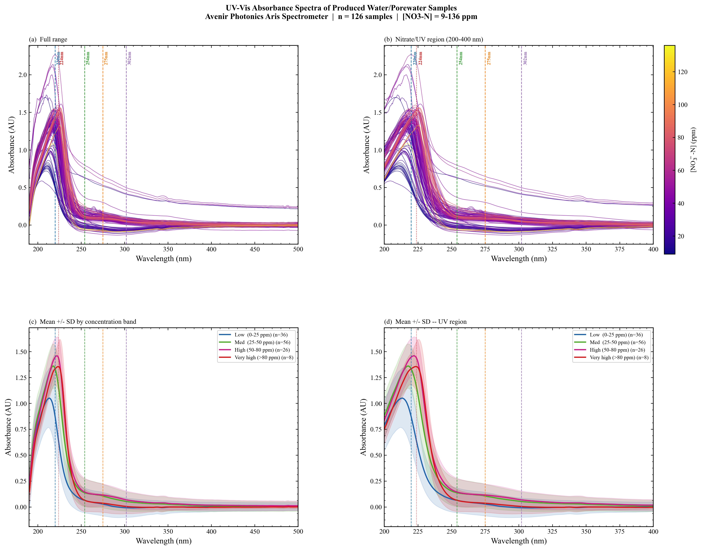

# Thesis Sub-Project: Sensor and Instrument Testing

Part of the M.Sc. thesis *Machine Learning-Enhanced Real-Time UV Spectroscopic Monitoring of Soil Nitrate* (Hochschule Furtwangen / Hahn-Schickard, Oct 2025 - Jun 2026).

Bring-up and troubleshooting scripts for the Avenir Photonics Aris UV-Vis spectrometer (USB, 2048 px, 183-989 nm) and spectral quality control (flagging faulty spectra and outliers before modelling).

| Folder | Content |
|---|---|
| `hardware_tests/` | USB connection and spectrum read test, step-by-step fault finding |
| `spectral_qc/` | outlier / bad-sample detection, interactive spectra viewer |

Main project: [uv-vis-nitrate-realtime](https://github.com/parky523/uv-vis-nitrate-realtime). Other thesis sub-projects: [thesis-3d-printed-design](https://github.com/parky523/thesis-3d-printed-design), [thesis-arduino-autosampler](https://github.com/parky523/thesis-arduino-autosampler), [thesis-realtime-gui](https://github.com/parky523/thesis-realtime-gui), [thesis-model-performance-testing](https://github.com/parky523/thesis-model-performance-testing).

*History note: these files were uploaded together on 2026-10-23. Commit dates were set to each file's last-modified date on my PC (the date the work was done); the README was written at upload.*
